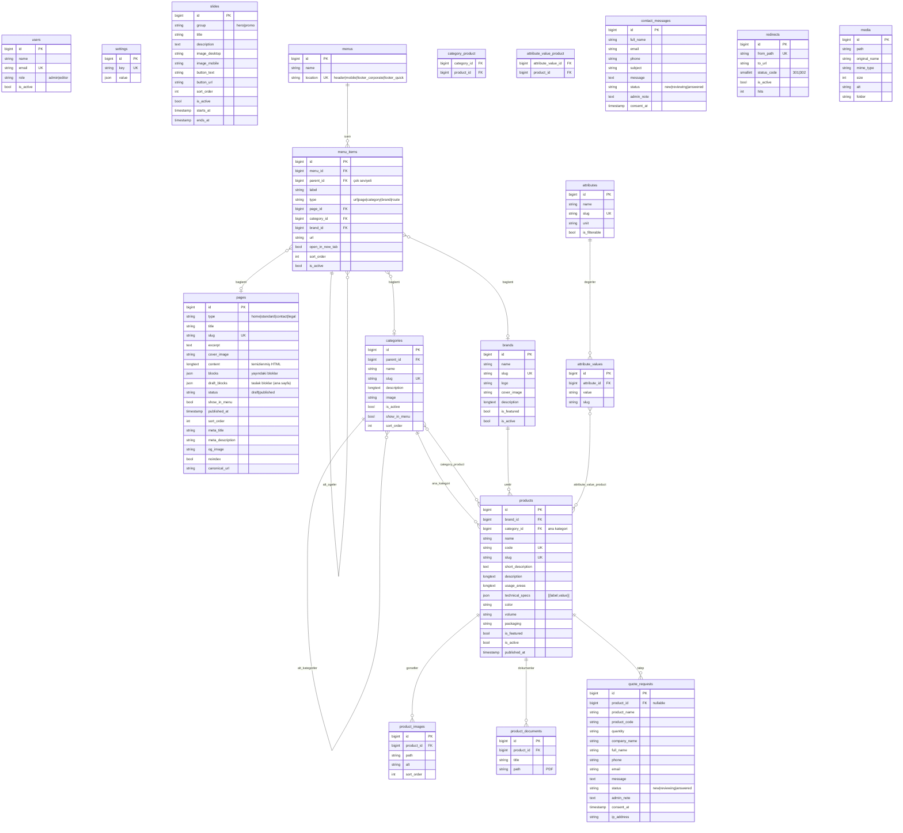

# Dyson Tedarik — Mimari Plan

Bu doküman projenin teknik mimarisini, veri modelini ve CMS blok sisteminin veri yapısını tanımlar.
Durum bilgisi için bkz. [ILERLEME.md](ILERLEME.md).

## 1. Teknoloji yığını (doğrulanmış sürümler)

| Katman | Teknoloji | Kurulu sürüm |
|---|---|---|
| Dil | PHP | 8.3.36 (Laravel 13 için min. 8.3) |
| Framework | Laravel | 13.39 |
| Yönetim paneli | Filament | 5.11 (Livewire 4) |
| Veritabanı | MySQL | 8.4 (MariaDB 10.6+ ile de uyumlu) |
| Ön yüz | Blade + Tailwind CSS 4 + Alpine.js | Vite 7 ile derlenir |
| HTML temizleme | symfony/html-sanitizer | 7.4 (8.x PHP 8.4 istediği için 7.4 seçildi) |

Node.js yalnızca geliştirmede `npm run build` için kullanılır; derlenmiş `public/build` dosyaları sunucuya yüklenir.
cPanel'de sürekli çalışan bir Node süreci gerekmez.

## 2. Katmanlar

```
app/
  Enums/                 Rol, içerik durumu, talep durumu, menü konumu vb. (PHP backed enum)
  Models/                Eloquent modelleri (+ HasSeo, HasSlug trait'leri)
  Models/Concerns/       Ortak model davranışları
  Policies/              Rol tabanlı yetkilendirme (admin / editor)
  Services/              SettingsService (önbellekli ayarlar), HtmlSanitizer, MenuService
  Support/Blocks/        CMS blok kayıt defteri (BlockRegistry) ve blok tanımları
  Filament/              Admin paneli: Resources, Pages, Widgets
  Http/Controllers/      Ön yüz controller'ları (ince; iş mantığı Service/Action'da)
  Http/Requests/         Form Request doğrulamaları (teklif, iletişim)
  Actions/               Tek amaçlı iş akışları (ör. SubmitQuoteRequest)
resources/views/
  components/            Yeniden kullanılabilir Blade bileşenleri
  blocks/                Her CMS blok türü için tek bir güvenli Blade şablonu
```

İlkeler:
- **Sabit kalan:** tasarım bileşenleri ve uygulama mantığı. **Veritabanından gelen:** tüm metinler, görseller, menüler, ürünler.
- Yönetici hiçbir alanda ham PHP/JS çalıştıramaz. Zengin metin HTML'i kayıt sırasında **ve** çıktıda beyaz liste ile temizlenir.
- Gizli bilgiler (SMTP şifresi, API anahtarları) yalnızca `.env` dosyasındadır; panelde gösterilmez.

## 3. Roller ve yetki

| Modül | admin | editor |
|---|---|---|
| Ana sayfa, kurumsal sayfalar, slider/banner, medya | ✔ | ✔ |
| Ürün, kategori, marka, özellik | ✔ | ✔ |
| Menü ve footer | ✔ | ✔ |
| Teklif talepleri / iletişim mesajları | ✔ (silme dahil) | Görüntüle, durum ve not güncelle |
| SEO yönlendirmeleri | ✔ | ✔ (silme hariç) |
| Site ayarları | ✔ | ✖ |
| Kullanıcılar ve roller | ✔ | ✖ |

Yetki kontrolleri Policy sınıflarında yapılır; Filament bunları sunucu tarafında uygular.
Pasif (`is_active = false`) kullanıcılar panele giremez.

## 4. ER diyagramı



SEO alanları (`meta_title`, `meta_description`, `og_image`, `noindex`, `canonical_url`) `pages`, `categories`, `brands`,
`products` tablolarında ortak `HasSeo` trait'i ile yönetilir.

### Önemli indeksler
- `products`: `code` (unique), `slug` (unique), `(is_active, is_featured)`, `brand_id`, `category_id`, `name`
- `categories`: `slug` (unique), `(parent_id, sort_order)`
- `pages`: `slug` (unique), `(type, status)`
- `slides`: `(group, is_active, sort_order)`
- `menu_items`: `(menu_id, parent_id, sort_order)`
- `quote_requests`, `contact_messages`: `(status, created_at)`
- `redirects`: `from_path` (unique)

## 5. CMS blok sistemi

Ana sayfa ve kurumsal sayfa blokları `pages.blocks` (yayında) ve `pages.draft_blocks` (taslak) JSON sütunlarında,
Filament `Builder` bileşeninin ürettiği yapıda saklanır:

```json
[
  {
    "type": "hero_slider",
    "data": {
      "is_active": true,
      "visibility": "all",
      "variant": "full",
      "slide_group": "hero"
    }
  },
  {
    "type": "featured_products",
    "data": {
      "is_active": true,
      "visibility": "all",
      "variant": "grid",
      "title": "Öne Çıkan Ürünler",
      "subtitle": null,
      "limit": 8
    }
  }
]
```

Her blokta ortak alanlar:

| Alan | Açıklama |
|---|---|
| `is_active` | Blok gösterilsin mi |
| `visibility` | `all` / `desktop` / `mobile` — mobil görünüm kontrolü |
| `variant` | Bloğa özel önceden tanımlı tasarım varyantı |
| `anchor` | İsteğe bağlı sayfa içi bağlantı kimliği |

Blok türleri (`App\Support\Blocks\BlockRegistry`):

| Tür | Kullanım | Varyantlar |
|---|---|---|
| `hero_slider` | Slider kayıtlarını gösterir | full, contained |
| `category_cards` | Seçili / ana kategoriler | grid, carousel |
| `featured_products` | `is_featured` ürünler | grid, carousel |
| `latest_products` | Son eklenen ürünler | grid, carousel |
| `featured_brands` | Marka logoları | logos, cards |
| `about_intro` | Firma tanıtımı (metin + görsel) | image_left, image_right |
| `features` | Neden Biz? / Kalite ve güven (ikonlu liste) | cards, list |
| `stats` | İstatistikler | dark, light |
| `promo_banners` | Ürün tanıtım bannerları (slides.group = promo) | two_column, full |
| `whatsapp_cta` | WhatsApp iletişim alanı | default |
| `contact_cta` | İletişim çağrısı | dark, accent |
| `rich_text` | Serbest zengin metin | narrow, wide |
| `text_image` | Metin + görsel | image_left, image_right |
| `image` | Tek görsel | contained, full |

Ön yüzde her tür yalnızca `resources/views/blocks/{tür}.blade.php` şablonuyla çizilir. Bilinmeyen tür sessizce atlanır.
Zengin metin alanları kayıtta `HtmlSanitizer` ile temizlenir.

**Taslak / yayın akışı (ana sayfa):** yönetici blokları düzenleyip *Taslağı kaydet* der (`draft_blocks`).
*Yayınla* eylemi taslağı `blocks` alanına kopyalar ve `published_at` günceller. Yöneticiler `?onizleme=1` ile taslağı görebilir.

## 6. Ayarlar

`settings` tablosu anahtar/değer (JSON) yapısındadır ve `SettingsService` üzerinden önbellekli okunur
(kayıtta önbellek temizlenir). Gruplar: `general`, `contact`, `social`, `seo`, `footer`, `integrations`.
Analytics için yalnızca ölçüm kimliği (ör. `G-XXXX`) saklanır; ham script girilemez.

## 7. Dosya yükleme güvenliği
- Görseller: yalnızca `image/jpeg`, `image/png`, `image/webp`, en fazla 5 MB. SVG, içinde script taşıyabildiği için kabul edilmez.
- PDF: yalnızca `application/pdf`, en fazla 20 MB.
- Dosyalar `storage/app/public` altında rastgele adlarla saklanır; `public/storage` sembolik bağlantısı ile sunulur.
- `storage/app/private` web üzerinden erişilemez.

## 8. cPanel yayın modeli
- Proje dosyaları `~/dysontedarik` dizinine, domain'in document root'u `~/dysontedarik/public` olarak ayarlanır.
- Document root değiştirilemiyorsa `public_html` içine yalnızca `public` içeriği kopyalanır ve `index.php` yolları güncellenir.
- Cron: `* * * * * php ~/dysontedarik/artisan schedule:run` (kuyruk işleri `queue:work --stop-when-empty` ile zamanlayıcıdan).
- Ayrıntılı adımlar Aşama 6'da `docs/DEPLOY.md` içinde verilecek.
